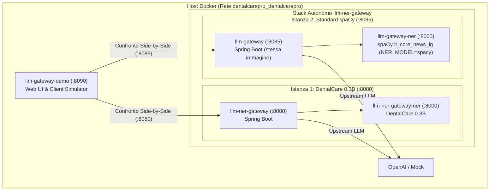

# `llm-gateway-demo` — Suite di Collaudo e Ispettore Side-by-Side

[](#1-architettura-container-docker-e-assegnazione-porte)
[](https://fastapi.tiangolo.com/)
[](#2-funzionalità-della-web-ui-http1921680728090)
[](#1-architettura-container-docker-e-assegnazione-porte)

Applicazione web containerizzata (porta **`8090`**) progettata per collaudare, ispezionare visivamente a 3 pannelli e confrontare in tempo reale (Side-by-Side) le chiamate verso modelli linguistici:
1. **`llm-ner-gateway`** (porta **`8080`**): Gateway primario con motore Dual-Engine specializzato **`llm-ner-dentalcare-0.3B`** (F1 0.985, immunità da falsi positivi sui menu DentalCare), validazione checksum Partita IVA Luhn, categorie estese (`ADDRESS`, `CATASTO`, `DOCID`, `TARGA`) e modalità Pass-Through.
2. **`llm-gateway`** (porta **`8085`**): Gateway di confronto con motore standard **`spaCy` (`it_core_news_lg`)**.

> [!IMPORTANT]
> **AUTONOMIA TOTALE E ZERO DIPENDENZE ESTERNE**
> La suite demo **non dipende da repository legacy o cartelle esterne** per il modello spaCy.
> Entrambe le istanze del gateway sono erogate dallo stack containerizzato **`llm-ner-gateway`**, che ingloba nativamente sia il modello 0.3B sia il modello spaCy (`NER_MODEL=spacy`). L'intero ecosistema opera in container Docker sulla rete `dentalcarepro_dentalcarepro`.

---

## 1. Architettura Container Docker e Assegnazione Porte

Tutti i servizi operano come container Docker orchestrati sulla rete `dentalcarepro_dentalcarepro` (server `192.168.0.72` o ambiente Docker dedicato):



| Servizio | Container Docker | Porta Esposta | Ruolo Operativo |
| :--- | :--- | :---: | :--- |
| **`llm-gateway-demo`** | `llm-gateway-demo` | **`8090`** | Web UI, Simulatore Client JWT `ES256`, Mock/Inspector OpenAI |
| **`llm-ner-gateway`** | `llm-ner-gateway` | **`8080`** | Gateway primario con modello odontoiatrico 0.3B |
| **`llm-ner-gateway-ner`**| `llm-ner-gateway-ner` | — | Microservizio Dual-Engine 0.3B (rete interna porta 8000) |
| **`llm-gateway`** | `llm-gateway` | **`8085`** | Gateway di confronto erogato dal medesimo stack con spaCy |
| **`llm-gateway-ner`** | `llm-gateway-ner` | — | Microservizio con `NER_MODEL=spacy` (rete interna porta 8000) |

---

## 2. Funzionalità della Web UI (`http://192.168.0.72:8090`)

### 2.1 Health Check Dinamico con Badge di Stato (Polling ogni 4s)
L'interfaccia interroga continuamente gli endpoint di telemetria `/v1/status` e `/actuator/health` di entrambi i gateway:
- 🟢 Pallino verde + badge verde **`[NER ATTIVO]`**: Gateway operativo con sanitizzazione e pseudonimizzazione privacy attive.
- 🟠 Pallino verde + badge arancione **`[PASS-THROUGH]`**: Gateway operativo in modalità pass-through trasparente (richieste e risposte inoltrate senza alterazione).
- 🔴 Pallino rosso: Servizio offline o non raggiungibile.
- I titoli dei gateway nel menu a tendina di selezione si aggiornano dinamicamente riflettendo lo stato corrente.

### 2.2 Ispezione a 3 Pannelli
Visualizzazione chiara del flusso end-to-end con evidenziazione sintattica colorata:
1. **Pannello 1 (Client $\rightarrow$ Gateway)**: Payload originario dell'applicazione con evidenziazione in giallo dei dati personali identificativi (PII) rilevati.
2. **Pannello 2 (Gateway $\rightarrow$ Fornitore LLM)**: Payload effettivamente intercettato prima dell'inoltro a monte, con token pseudonimi (`PERSONA_1`, `TEL_1`), segnaposto irreversibili (`[CATASTO]`), UUID surrogati e lista dei campi DTO rimossi con `DROP`.
3. **Pannello 3 (Gateway $\rightarrow$ Client)**: Risposta finale restituita all'applicazione con i dati personali correttamente ripristinati e misurazione della latenza in millisecondi.

### 2.3 Modalità Fornitore Flessibile
- **Mock Intelligente Offline (Zero Costi)**:
  - Replica fedelmente le risposte del provider LLM senza spendere token API né trasmettere dati all'esterno.
  - Risponde riutilizzando i token pseudonimi ricevuti per verificare il ripristino automatico.
  - **Toggle Allucinazione Token**: inietta deliberatamente un token sconosciuto (`PERSONA_99`) per verificare sul campo la protezione fail-closed **`502 UNKNOWN_TOKEN`**.
- **OpenAI Reale**:
  - Inoltra la richiesta pseudonimizzata all'endpoint ufficiale OpenAI.
  - Supporta sia la chiave preconfigurata a livello server (`config_ner_demo/config.yaml`), sia l'inserimento dinamico a runtime dall'interfaccia utente.

### 2.4 Confronto Side-by-Side (Dual Execution)
Consente di inviare simultaneamente lo stesso messaggio a **Gateway 1 (`llm-ner-gateway` :8080)** e **Gateway 2 (`llm-gateway` :8085)**, evidenziando le differenze su:
- Isolamento dei verbi imperativi di contatto (*"Chiama"* vs *"Mario Rossi"*).
- Gestione dei menu applicativi DentalCare (zero falsi positivi nel modello 0.3B vs falsi positivi in spaCy).
- Checksum Luhn 11 cifre su Partita IVA (validazione corretta vs riconoscimento come numero generico).

---

## 3. Gli 11 Scenari Preconfigurati di DentalCare

I test predefiniti simulano i flussi e le strutture DTO reali di DentalCare Pro:

| # | Scenario | Policy Attiva | Obiettivo del Test |
|---|:---|:---|:---|
| **1** | **Comando Breve e Verbi di Contatto** | `dentalcare / copilot-admin` | Dimostra come il modello 0.3B isoli il nome proprio senza inglobare il verbo imperativo (*"Chiama"*). |
| **2** | **Contesto UI + `PatientDetailDto` (2 Passate)** | `dentalcare / copilot-admin` | Verifica la risoluzione a 2 passate del contesto UI (`[CONTESTO UI]`), surrogato UUID e il `DROP` di 13 campi clinici/fiscali. |
| **3** | **Anamnesi e Note Cliniche** | `dentalcare / clinical-copilot` | Verifica che i flag clinici (`bloodType`, `toothNumber`, `allergyPenicillin`) passino in chiaro (`ALLOW`), mentre le note libere vengono bonificate (`TEXT`) e i campi fiscali eliminati (`DROP`). |
| **4** | **Briefing Mattutino e Agenda (`getDashboard`)** | `dentalcare / copilot-admin` | Verifica la sanitizzazione ricorsiva dell'array `todayAppointments` (`NESTED`) e il `DROP` di note riservate. |
| **5** | **Richiami Periodici Scaduti (`getRecalls`)** | `dentalcare / copilot-admin` | Verifica la sanitizzazione di liste `List<RecallDto>` con pazienti multipli. |
| **6** | **Fatturazione, P.IVA, SDI e Indirizzi (`getInvoices`)** | `dentalcare / copilot-admin` | Confronto su Partita IVA (checksum Luhn 11 cifre), CF, IBAN e categorie estese (`ADDRESS`, `CATASTO`, `DOCID`, `TARGA`). |
| **7** | **Preventivo AI da Odontogramma (`getEstimates`)** | `dentalcare / clinical-copilot` | Conservazione dei numeri dentali (#16, #24, #36) e importi economici con pseudonimizzazione di paziente e medico. |
| **8** | **Smart Error Sistema TS / SDI (#54)** | `dentalcare / smart-error` | Verifica del formato `OPERAZIONE / CODICE / MESSAGGIO` con redazione irreversibile (`[NOME]`, `[ID]`, `[TELEFONO]`, `[EMAIL]`). |
| **9** | **Voci di Menu DentalCare e Nomi Ambigui** | `dentalcare / copilot-admin` | Verifica dell'assenza totale di falsi positivi sulle sezioni applicative (*Agenda*, *Fatturazione*, *Magazzino*) e riconoscimento di nomi omografi. |
| **10**| **Sicurezza Fail-Closed su Tool Call** | `dentalcare / copilot-admin` | Blocca all'istante con errore `502 UNKNOWN_TOKEN` il tentativo del modello di invocare `getPatientDetail` con un token allucinato (`PERSONA_99`). |
| **11**| **Pratica Legale / Perizia Odontoiatrica** | `legal / case-analysis` | Scenario giuridico completo con policy estesa. |

---

## 4. Installazione e Gestione tramite Script Server

La gestione del container `llm-gateway-demo` e dello stack `llm-ner-gateway` è interamente automatizzata dagli script bash nel repository:

### 4.1 Installazione Automatica da Zero (`scripts/install-llm_gateway.sh`)
Eseguire da `~/docker` sul server Docker (`192.168.0.72`):
```bash
cp llm-ner-gateway/scripts/install-llm_gateway.sh ./
chmod +x install-llm_gateway.sh
./install-llm_gateway.sh
```
Lo script:
1. Verifica Docker, Docker Compose, Git e OpenSSL.
2. Crea/valida la rete Docker `dentalcarepro_dentalcarepro`.
3. Clona `llm-ner-gateway` e `llm-gateway-demo`.
4. Genera la coppia di chiavi EC P-256 (`keys/client-private.pem` e `keys/client-public.pem`) utilizzata dal simulatore client per firmare i token JWT `ES256`.
5. Sincronizza `client-public.pem` nel gateway.
6. Configura `config_ner_demo/config.yaml` puntando ai due gateway containerizzati (:8080 e :8085).
7. Compila e avvia i container con `docker compose up -d --build`.

### 4.2 Aggiornamento Continuo Idempotente (`scripts/update-llm-gateway.sh`)
Eseguire da `~/docker` sul server per applicare gli aggiornamenti da GitHub:
```bash
./update-llm-gateway.sh
```
Lo script:
1. Esegue `git pull origin main` per entrambi i repository.
2. Preserva tutte le configurazioni e le chiavi crittografiche create in precedenza.
3. Verifica e ripristina i permessi di sicurezza (`chmod 644`).
4. Ricompila e riavvia i container con zero downtime non programmato.

---

## 5. Configurazione: `./config_ner_demo/config.yaml`

Nel container Docker, la cartella `./config_ner_demo` è montata in sola lettura (`/app/config_ner_demo:ro`):

```yaml
server:
  host: "0.0.0.0"
  port: 8090

keys:
  dir: "./keys"
  private_key: "./keys/client-private.pem"
  public_key: "./keys/client-public.pem"

gateways:
  llm_ner_gateway:
    url: "http://llm-ner-gateway:8080"
    ner_url: "http://llm-ner-gateway-ner:8000"
    label: "llm-ner-gateway (DentalCare 0.3B — :8080)"
    short_label: "llm-ner-gateway (0.3B)"

  llm_gateway:
    url: "http://llm-gateway:8085"
    ner_url: "http://llm-gateway-ner:8000"
    label: "llm-gateway (Standard spaCy — :8085)"
    short_label: "llm-gateway (spaCy)"

openai:
  url: "https://api.openai.com/v1/chat/completions"
  api_key: ""
```

---

## 6. Esecuzione Docker Standalone

Per avviare o riavviare solo il container della demo:
```bash
docker compose up -d --build
```
L'interfaccia sarà immediatamente accessibile su **`http://<SERVER_IP>:8090`**.
